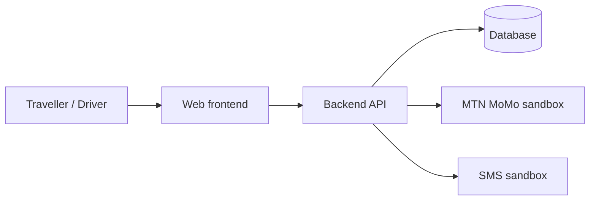

# ETIKE Intercity Travel Platform

One place to book intercity travel in Rwanda: bus tickets, private rides and shared seats.

<!-- TODO: Add CI and license badges once a workflow file and a LICENSE exist. -->

## Overview

Travelling between districts in Rwanda usually takes two trips to the bus terminal: one to buy a ticket and another to travel. Each bus company sells only its own tickets, so there is no single place to compare times and prices.

Finding a private car to another district at a fair, known price is also hard. At the same time, drivers who want long trips struggle to find customers.

ETIKE brings intercity travel into one platform. Travellers can compare and book bus tickets from several operators, book a private ride with the price shown up front, or take a cheaper shared seat in a private car that is already going the same way.

## Key features

| Feature | Status |
|---|---|
| Bus tickets from several operators in one place (prototype uses sample data for 3–4 operators) | <!-- TODO: confirm once implemented --> In development |
| Private rides between districts, with the price shown up front | <!-- TODO: confirm once implemented --> In development |
| Shared seats in private cars going the same way | <!-- TODO: confirm once implemented --> In development |
| Payments through the MTN MoMo sandbox | <!-- TODO: confirm once implemented --> In development |
| SMS notifications through an SMS sandbox | <!-- TODO: confirm once implemented and name the provider --> In development |
| Car rental | Planned |

**Revenue model:** a small booking fee on each booking.

## Tech stack

<!-- TODO: Fill in from package files, Dockerfiles, configs and CI workflows once they exist (frontend, backend, database, hosting). -->

## Architecture

The diagram below shows the **intended** high-level design. Update it to match the real structure once the code exists.

<!-- TODO: Replace with the real components and the name of the SMS provider. -->

## Project structure

<!-- TODO: Add a trimmed directory tree with one-line descriptions once the code is committed. -->

## Getting started

### Prerequisites

<!-- TODO: List required tools and versions (from engines field, .nvmrc, Dockerfile, etc.). -->

### Installation

<!-- TODO: Add verified install commands. -->

### Environment variables

<!-- TODO: Build this table from .env.example or from where the code reads env vars. Names and purpose only, never real values. -->

| Variable | Purpose |
|---|---|
| <!-- TODO --> | <!-- TODO --> |

### Database setup

<!-- TODO: Document database creation, migrations and seed data (including the sample bus operator data). -->

### Running locally

<!-- TODO: Add verified commands to run the app locally, with and without Docker if both are supported. -->

## Running tests

<!-- TODO: Add the real test commands. -->

## API overview

<!-- TODO: List the main endpoints grouped by resource (e.g. bus trips, rides, shared seats, bookings, payments) from the route definitions. Link Swagger/OpenAPI docs if they exist. -->

## Deployment

<!-- TODO: Describe the CI/CD pipeline and the staging and production environments from the workflow files and deploy configs. -->

## Data protection and ethics

- The project follows Rwanda's **Law No. 058/2021 on the protection of personal data and privacy**.
- We collect only the data needed to make and manage a booking.
- Payments run in the **MTN MoMo sandbox**. No real money moves in the prototype.
- Bus operators and schedules in the prototype are **sample data**, not live timetables.

## Roadmap

- Car rental
- Live integrations with bus operators (replacing sample data)
- USSD access for users without smartphones or mobile data

## Team

Team 3, African Leadership University (ALU), Kigali

| Name | Role |
|---|---|
| Fabrice | Technical Lead, System Architect & DevOps |
| Ian Kamuzinzi | Database & Backend |
| Bagabo Lewis | Backend & Integrations |
| Alida Keza (Dana) | UI/UX & Frontend |
| Parfaite Ishimwe (Nyange) | Project Manager |
| Joel Mucyo | Research & QA |

<!-- TODO: Add a GitHub handle column once the commit history shows each member's account. -->

## Acknowledgements

- **African Leadership University (ALU)**, Kigali
- **Hubert Apana**, facilitator and learning coach, for guidance throughout the project

## License

<!-- TODO: Choose a license and add a LICENSE file, then update this section. -->
