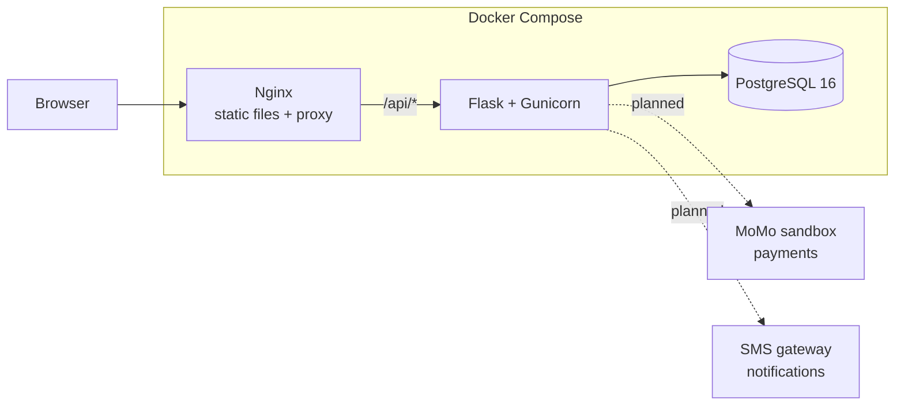

# Architecture

ETIKE is a three-tier client–server application. Everything runs in Docker containers started by Docker Compose.

| Tier | Technology | Job |
|------|------------|-----|
| Frontend | Plain HTML, CSS and JavaScript | What passengers, drivers and staff see in the browser |
| Backend | Python 3.12, Flask REST API, Gunicorn | Business rules and data access, exposed under `/api` |
| Database | PostgreSQL 16 | Stores all data |

Nginx sits in front. It serves the frontend files directly and forwards every `/api/*` request to Flask. The browser only ever talks to Nginx, so there is no cross-origin traffic.

Solid lines exist in Sprint 1. Dotted lines are planned for later sprints.

## Environments

- **Local**: `docker-compose.yml`. Flask dev server with auto-reload, code mounted from your machine.
- **Staging and production**: `docker-compose.prod.yml` on a VPS. Gunicorn, restart policies, secrets from the server's `.env`. Staging and production are separate servers (or separate folders with separate `.env` files).

## CI/CD

- `ci.yml` runs ruff and pytest (against a Postgres service container) on every pull request and every push to `main`.
- `deploy.yml` runs on every push to `main`: it SSHes into the staging server, runs `git pull`, then `docker compose -f docker-compose.prod.yml up -d --build`.
- Required GitHub secrets: `STAGING_HOST`, `STAGING_USER`, `STAGING_SSH_KEY`.

## Preparing the VPS

1. Install Docker Engine and the Compose plugin (https://docs.docker.com/engine/install/ubuntu/).
2. Create a deploy user, add it to the `docker` group, and add the public half of a new SSH key pair to `~/.ssh/authorized_keys`. Put the private half in the `STAGING_SSH_KEY` secret.
3. Clone the repository to `~/etike` (the deploy workflow expects this path). Use a read-only deploy key if the repo is private.
4. In `~/etike`, run `cp .env.example .env`, set `FLASK_ENV=production`, and replace every `change-me` with a strong value. Make `DATABASE_URL` match the Postgres user, password and database.
5. Run `docker compose -f docker-compose.prod.yml up -d --build` once by hand and check `curl http://localhost/api/health`.
6. Open ports 22, 80 and 443 in the firewall; close everything else.

## HTTPS with Let's Encrypt

Certificates are issued on the server with Certbot, outside Docker, and Nginx reads them from `/etc/letsencrypt`.

1. Point your domain's DNS A record at the server.
2. `sudo apt install certbot` and `sudo mkdir -p /var/www/certbot`.
3. With the stack running on port 80, get a certificate:
   `sudo certbot certonly --webroot -w /var/www/certbot -d YOUR_DOMAIN`
4. Copy `nginx/https.conf.example` to `nginx/https.conf`, replace `YOUR_DOMAIN`, and in `docker-compose.prod.yml` change the mounted file from `./nginx/default.conf` to `./nginx/https.conf`.
5. Restart: `docker compose -f docker-compose.prod.yml up -d`.
6. Certbot renews automatically; reload Nginx after renewal by adding `--deploy-hook "docker compose -f /home/DEPLOY_USER/etike/docker-compose.prod.yml exec nginx nginx -s reload"` to the renewal config, or run that command monthly.

## Where future code goes

Each module below becomes a Flask blueprint in `backend/app/routes/`, models in `backend/app/models/`, and its own tests in `backend/tests/`. Nothing here is built yet.

| Module | Purpose |
|--------|---------|
| auth | Sign up, log in, sessions or tokens |
| users | Passenger and admin accounts |
| drivers | Driver profiles and verification |
| vehicles | Cars and their seats |
| bus_companies | Companies and their staff |
| routes | Real district-to-district routes |
| bus_trips | Scheduled bus departures and seats |
| ride_offers | Private and shared car trips offered by drivers |
| bookings | Seat and car reservations |
| payments | MoMo sandbox integration |
| ratings | Passenger and driver feedback |
| notifications | SMS and in-app messages |
